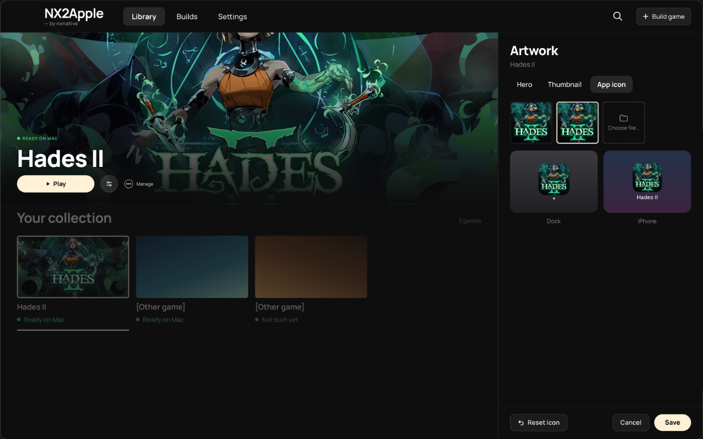
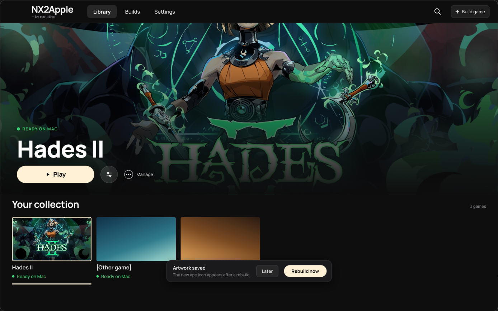

# Handoff: the App icon tab (LNPANDY/NX2Apple#775)

The third tab of the artwork editor (#798 added Hero and Thumbnail). Read issue #775 and its comments first. **Delete
`.handoff/` in the last commit, before the pull request.**

## The mockups

**The App icon tab.** Sources: the game's own icon (the default), the eShop icon (1024×1024), or **Choose file…**.
Below, the chosen icon in the Mac Dock (with a running app's dot) and on an iPhone Home Screen (with the game's name).
**Reset icon** shows once the choice differs from the default.

**After Save.** When the icon of a built game changed, a notice slides up from the bottom of the library: the new icon
appears after a rebuild, with **Later** and **Rebuild now**.

## Already on this branch

- `patches/0089-…`: seedds/nxnative#1380 (mbanusic), `--icon IMAGE` for `build_ipa_from_nsp.py`. Pass it for the Mac
  app and the one-game IPA only, never for the shared NX2Apple app, which keeps its own icon (decided in #775).
- `prototype/`: the tab as first built on older code (module `NSPortBuilder`, strings in `Localization.swift`, icon
  through `DM_ICON`). For reference only. Do not apply it.
